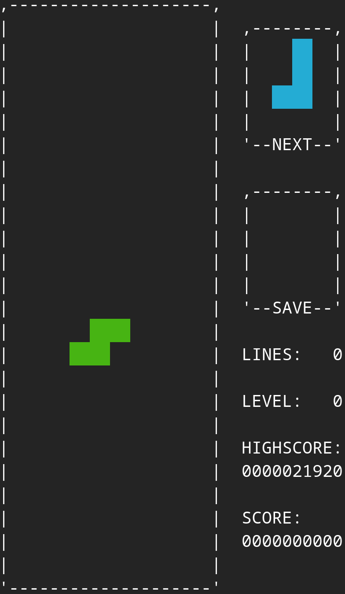
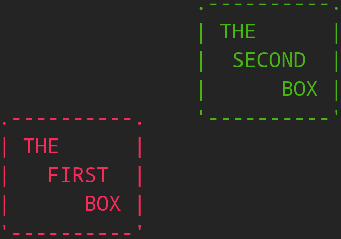

[EN]
# Making a simple Tetris game in the terminal
When trying to learn how to code complex projects, it can be hard going from the simple `farenheit.c` example to a fully GPU rendered game. As so, and as I have done myself, I think the best intermediate project to attempt is a terminal-rendered game.

In this blog, I will build a simple terminal-rendered ***Tetris*** using ASCII characters and terminal escape sequences (for colors and such). This project will be built from the ground up (no dependencies on libraries not preinstalled on basically every machine) to be as accessible as possible. You can find the finished game in this [GitHub repository](https://github.com/SupSyDeMarciou/tetris).

The main objective is to have fun: this is not a tutorial on efficient TUI application design, general software development or game design. My goal is to make this project as well documented as possible to help new C programmers have a better grasp of how to actually achieve such a project.

## Summary
1. A common base for terminal-rendered applications  
    1.1 How to draw using a terminal  
    1.2 How to query user inputs  
    1.3 Architecture of the project  
2. Practical example: The game of Tetris  
    2.1 The core gameplay loop  
    2.2 How to manage the pieces  
    2.3 Creating a simple menu  




# 1. A common base for terminal-rendered applications

## 1.1 How to draw using a terminal

The main idea behind drawing in the terminal is the same as when drawing *ASCII-Art*: we use the characters as lines and/or values in a grid (unlike a grid of *pixels*) to build up larger shapes.
```
                ^     ^
               / \___/ \
            __/  _   _  \__
            ===    ^    ===  ,--,
               '--   --'    /    \
               /   V   \    |   _/
              |  | | |  |   /
             (,_(,,|,,)_,)-"

Cat in ASCII-ART (only for illustrative purposes)
```

The large majority of terminals display text in a *monospace* font (meaning that each character is the same width, just like in the font I use for this website). Therefore, we can think of the terminal window as a *grid* of characters, each occupying a rectangle of roughly 2:1 proportions. Thanks to this consistency, we can *draw* shapes anywhere in the terminal window without worrying about distorsions due to varying character widths.

We can index the different characters based on which column and row they occupy, just like a pixel on a screen. If we imagine printing an image row by row in the terminal, then a *row* would be a `'\n'` terminated line (if we assume the terminal window is wide enough) and a *column* would be the character's position within this line :
```C
printf(
    ".----------.\n" //
    "| JUST     |\n" //
    "|     A    |\n" // In C, string litterals are automaticaly concatenated if nothing separates
    "|      BOX |\n" // them. Therefore, these five lines form a single string litteral
    "'----------'\n" //
);
// Expected:
//              1
//    0 2 4 6 8 0
// 0  .----------.
// 1  | JUST     |
// 2  |     A    |
// 3  |      BOX |
// 4  '----------'
//
// Character 'A' is a position (6;2), so on position 6 of line 2
```

We have a random box, nice! However, if we want to draw anything else now it will have to be bellow this box as we can only print entire lines from top to bottom (less nice), so we will have to be thoughtfull of what we need to print and where we need it, so that we may sequence the print commands accordingly. Alternatively, we could store complete references to the lines to display within an editable buffer so that the order in which edits are made doesn't affect the result. In the game we are making, we will be using a bit of both :
```C
// This setup achieves the same result as the preview example. However, separating the lines like
// this allows us to index in which line we are (which may be useful when indexing an array for
// example).
for (int l = 0; l < 5; l++)
{
    switch (l)
    {
        case 0: printf(".----------."); break;
        case 1: printf("| THE      |"); break;
        case 2: printf("|   FIRST  |"); break;
        case 3: printf("|      BOX |"); break;
        case 4: printf("'----------'"); break;
    }

    printf("    "); // Four spaces

    switch (l)
    {
        case 0: printf(".----------."); break;
        case 1: printf("| THE      |"); break;
        case 2: printf("|  SECOND  |"); break;
        case 3: printf("|      BOX |"); break;
        case 4: printf("'----------'"); break;
    }

    printf("\n");
}

// Expected:
//              1 1 1 1 1 2 2 2 2
//    0 2 4 6 8 0 2 4 6 8 0 2 4 6
// 0  .----------.    .----------.
// 1  | THE      |    | THE      |
// 2  |   FIRST  |    |  SECOND  |
// 3  |      BOX |    |      BOX |
// 4  '----------'    '----------'
```

Thinking about printing in this way grants us much better flexibility in how to arrange our rendering logic.

Now that we can draw what we want, we need a way to clear the terminal or move the *cursor* (the position within the terminal window from which we print) back to the top of the terminal window again in order to draw the next *frame* of our application. To achieve this and much more, we will use ***[ANSI Escape Sequences](https://en.wikipedia.org/wiki/ANSI_escape_code)*** which are a set of commands one can use to manipulate the terminal's appearence and behaviour.

The commands we will use take the form `"\033[..."` and are to be placed within the text printing to the terminal. Indeed, `\033` is an *octal number* which equals 27 in decimal. This number is called the *escape code* and is pretty much standard throughout terminals as the introduction to a command (it is also referenced as `\e` in C). In our case, all commands will also have an opening square bracket `[` as the second byte because we only manipulate the terminal appearence (these are called *Control Sequence Introducer commands*).

Specificaly, we will need:
- `"\033[`*`n`*`J"` to erase the screen, with *`n`* either 0 (erase from cursor position to *end* of screen), 1 (erase from cursor position to *top* or screen) or 2 (erase *entire* screen).
- `"\033[`*`n`*`;`*`m`*`H"` to move the cursor to row `n` and column `m`.
- `"\033[`*`n`*`m"` to change the color (and other things) for the next print operations, with `n` an integer (the *[wikipedia page](https://en.wikipedia.org/wiki/ANSI_escape_code)* references all the possible values).

Using this, we can now make our boxes two different colors and bounce up and down :
```C
#include <stdio.h>
#include <unistd.h>
#include <math.h>

int main()
{
    // This is used for the box boucing, so that we have a time reference
    for (int frame_count = 0; ; ++frame_count)
    {
        const int offset1 = 2.5 + 2.5 * sin(frame_count * 0.1);
        const int offset2 = 2.5 - 2.5 * sin(frame_count * 0.1);

        printf(
            "\033[2J" // Clear entire screen
            "\033[1H" // Reset cursor position (top-left)
        );
        for (int l = 0; l < 10; l++) // We will work with 10 lines for the screen
        {
            
            printf("\033[31m"); // Set color to "red"
            switch (l - offset1) // Check current line
            {
                case 0:  printf(".----------."); break;
                case 1:  printf("| THE      |"); break;
                case 2:  printf("|   FIRST  |"); break;
                case 3:  printf("|      BOX |"); break;
                case 4:  printf("'----------'"); break;
                default: printf("            "); break; // If we're not drawing a box, then we draw
                          // blank characters to keep the spacing intact for the next box
            }
            printf("\033[0m"); // Reset color (not necessary, but good practice when you don't know
                               // what comes next).
            
            printf("    "); // Four spaces
            
            printf("\033[32m"); // Set color to "green"
            switch (l - offset2) // Same as the first box
            {
                case 0:  printf(".----------."); break;
                case 1:  printf("| THE      |"); break;
                case 2:  printf("|  SECOND  |"); break;
                case 3:  printf("|      BOX |"); break;
                case 4:  printf("'----------'"); break;
                default: printf("            "); break;
            }
            printf("\033[0m");
    
            printf("\n"); // Finish the row by passing a newline character
        }

        usleep(1000*1000/30); // Just to slow down the execution (we set a target of 30 frames per second, or 30 FPS)
    }
}
```
This programs outputs the following (just imagine the boxes moving up and down, I don't know how to embed video yet):



> **(i)** Technically, we could also use *ANSI escape sequences* to move the cursor to a specific coordinate using `"\033[n;mH"` as a replacement to printing line by line, but I prefer to limit my uses of escape sequences as, depending on the terminal *(looking at you, Windows terminals)*, printing may be slow and reducing the number of times we have to jump around and redraw can become crucial. This constraint also applies to changing color.

## 1.2 How to query user inputs

Now let's say we wanted to change the color of the second box based on user input, how do we do that ?  
This can be achieved in multiple ways, but the simplest is to listen to the *standard input stream (`stdin`)* and wait for the user to press a key:
```C
int c = getc(stdin);
printf("Got %c (%d)\n", c, c);
```
Sadly, this will not work as `stdin` is a `FILE *` so it is *buffered*, which means that a newline character has to be entered in order for `getc` to return (so everytime the user writes something, they would have to also press *enter* for their input to be taken into account).

What we want is a function that exactly retrieves a character from the standard input as soon as it is written. Such a function exists on *Windows* in the library `<conio.h>`, but on *Linux* we have to write it ourselves... So I didn't write it myself and found this on *StackOverflow*:
```C
#include <termios.h>
#include <unistd.h>
#include <stdio.h>

int getch(void) {
    // credits: https://stackoverflow.com/questions/3276546/how-to-implement-getch-function-of-c-in-linux
    struct termios oldattr, newattr;
    tcgetattr( STDIN_FILENO, &oldattr );
    newattr = oldattr;
    newattr.c_lflag &= ~( ICANON | ECHO );
    tcsetattr( STDIN_FILENO, TCSANOW, &newattr );
    int ch = getchar();
    tcsetattr( STDIN_FILENO, TCSANOW, &oldattr );
    return ch;
}
```
What it does is change the terminal I/O settings so that the standard input is no longer buffered for the duration of this function (this is why `oldattr` is queried, to put the terminal back to its initial state before the function is exited).

With this, we can use *macro magic* (basic `#if .. #else ... #endif`) to make our code compilable on both windows and linux:
```C
#include <stdio.h>

#ifdef _WIN32
#   include <conio.h>
#   define getch _getch
#else
#   include <termios.h>
#   include <unistd.h>
    int getch(void) {
        // credits: https://stackoverflow.com/questions/3276546/how-to-implement-getch-function-of-c-in-linux
        struct termios oldattr, newattr;
        tcgetattr( STDIN_FILENO, &oldattr );
        newattr = oldattr;
        newattr.c_lflag &= ~( ICANON | ECHO );
        tcsetattr( STDIN_FILENO, TCSANOW, &newattr );
        int ch = getchar();
        tcsetattr( STDIN_FILENO, TCSANOW, &oldattr );
        return ch;
    }
#endif
```

Now that we can retrieve inputs as they come, we can start to analyse what they look like. For characters from `a` to `z` and from `A` to `Z` (as well as some punctuation and whitespaces like `\n`), the `getch` function returns exactly their *ASCII code*. For more complex inputs like `left_arrow`, an *escape sequence* can occur. For the arrows, these sequences are:
- `"\033[A"` for `up_arrow`.
- `"\033[B"` for `down_arrow`.
- `"\033[C"` for `right_arrow`.
- `"\033[D"` for `left_arrow`.

> **(i)** These are also the sequences for moving the *cursor* (where the text is printed in the terminal window) in these directions. This shows how the escape sequences can be used to dialogue with the terminal (for example, we can ask for the cursor position with `"\033[6n"` and the terminal will respond with `"\033[`*`n`*`;`*`m`*`H"`, the sequence for moving the cursor to row `n` and column `m`).

These are composed of multiple characters so we have to call `getch` three times to retrieve the complete input, which can make our code messy when we will start to link inputs to game logic. To account for that, I decided to create an *enum* with the non-alphanumerical inputs and a function to deal with the `getch` calls for me:
```C
/// @brief Some non-alphanumerical inputs we might expect
typedef enum InputKey {
#ifdef _WIN32
    INPUT_ENTER       = '\r',
    INPUT_BACKSPACE   = '\b',
#else
    INPUT_ENTER       = '\n',
    INPUT_BACKSPACE   = 127,
#endif
    INPUT_A_CTRL      = 1,
    INPUT_C_CTRL      = 3,
    INPUT_V_CTRL      = 22,
    INPUT_X_CTRL      = 24,
    INPUT_Z_CTRL      = 26,
    
    ESCAPE_CODE       = 27,
    __INPUT_NON_ASCII = 256,
    INPUT_UP,
    INPUT_DOWN,
    INPUT_RIGHT,
    INPUT_LEFT,
} input_key;

/// @brief Get the last pressed key
/// @return The pressed input_key
int inputGet() {
    const int base = getch();
    if (base != ESCAPE_CODE) return base;

    const int expect_sqr_bracket = getch();
    if (expect_sqr_bracket != '[') return -1;

    const int c = getch();
    switch (c) {
        case 'A': return INPUT_UP;
        case 'B': return INPUT_DOWN;
        case 'C': return INPUT_RIGHT;
        case 'D': return INPUT_LEFT;
        default:  return -1;
    }
}
```
This function either returns an ASCII character or value from my aforementionned enum.

> ### /!\ WORK IN PROGRESS /!\
> This page will continue to be worked on